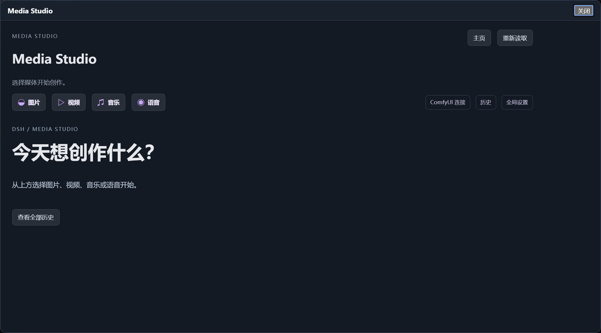
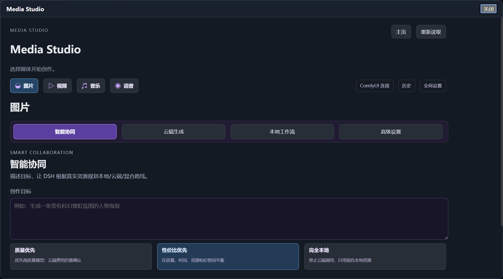
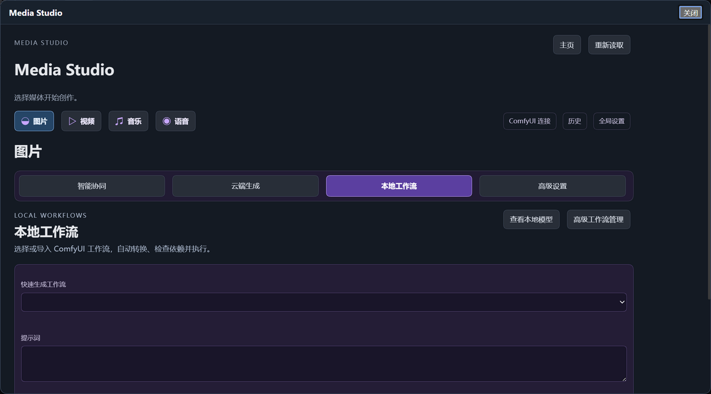
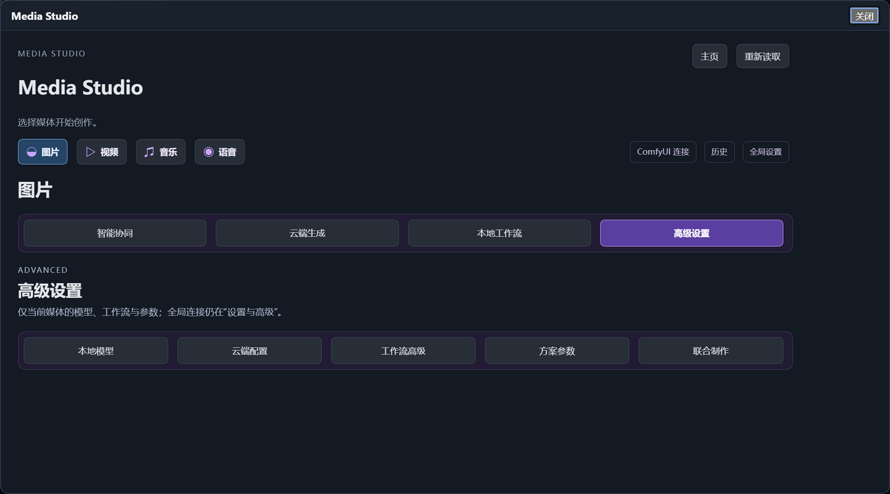

# DSH Media Studio 3.1

**面向 DeepSeek Harness（DSH）的图片、视频、音乐与语音创作界面。**

DSH Media Studio 不是另一套模型引擎。它把 DSH 的自然语言创作、ComfyUI 本地工作流和云端媒体服务组织成一个可视化工作区，让普通用户也能选择媒体类型、规划方案、执行任务并管理资源。自然语言创作仍然是主入口，Media Studio 负责可视化操作、资源发现和任务管理。

> 当前版本：`3.1.0-dev.75`  
> 状态：**Public Preview / Pre-release**，不是 Stable。



## 功能

- **四种媒体**：图片、视频、音乐、语音。
- **智能协同**：用自然语言描述目标，选择质量优先 / 性价比优先 / 完全本地，生成可审阅方案后执行。
- **内置 Skill**：安装后自动注册 `media-studio-creative`，DSH 模型可以查询真实资源、选择工作流并执行。
- **ComfyUI 工作流**：从 ComfyUI 扫描、导入、自动转换/绑定、查看依赖和常用参数、执行、归档和删除。
- **本地 / 云端 / 混合 / Auto**：复用已有执行器；没有 ComfyUI 时插件仍可加载和配置。
- **统一资源发现**：读取实例的真实加载器资源（checkpoint、UNET、text encoder、VAE、LoRA、ControlNet 等），而不是只猜文件夹。
- **任务与历史**：保留任务、历史、暂停、恢复、归档和永久删除记录。
- **本地语音**：识别 Windows SAPI 与可选 Piper 引擎，不要求必须有 ComfyUI 语音工作流。

## 界面

### 选择媒体后：智能协同 / 云端生成 / 本地工作流 / 高级设置



### 本地工作流



### 当前媒体的高级设置



## 兼容性

已实际验证的基线：

- Windows x64
- 官方 DSH `0.2.2-rc.1`
- Node.js `24.14+`（验收使用 Node `24.21`）
- ComfyUI 作为外部本地执行端，不随安装包分发

其他 DSH 版本、操作系统和 ComfyUI 版本未做完整承诺；请先使用隔离 profile 验证。

## 安装

从 [Releases](https://github.com/WDRSJ/dsh-media-studio/releases) 下载：

- `dsh-media-studio-3.1.0-dev.75.tgz`
- `SHA256SUMS.txt`

校验后安装到**隔离的 DSH profile**，不要直接覆盖日常安装：

```powershell
dsh plugin --profile <your-profile> add .\dsh-media-studio-3.1.0-dev.75.tgz
```

安装后重启该 profile，在 DSH 中打开 Media Studio。详细步骤见 [安装说明](docs/INSTALL.md)。

安装包**不包含** ComfyUI、云端账号、模型权重、Piper 模型或生成媒体。

## ComfyUI 首次连接

1. 启动本机 ComfyUI，确认 HTTP 服务可访问。
2. 打开 Media Studio → **ComfyUI 连接**。
3. 新增/确认实例地址，例如 `http://127.0.0.1:8188`。
4. 点击检测，确认实例与节点可用。
5. 在某个媒体的 **本地工作流** 中扫描/导入工作流，完成自动转换与绑定。
6. 选择实际模型和工作流后，在本地执行。

ComfyUI 的节点、自定义节点、模型和工作流由用户自行安装维护。完整说明见 [ComfyUI 连接与工作流](docs/COMFYUI.md)。

## 模型与工作流

- 模型权重不随本仓库或安装包分发。
- 本地模型来自用户已配置的 ComfyUI 实例；Media Studio 只读取实例提供的加载器与工作流能力。
- 云端模型与账号需用户自行配置，价格与实际可用性以供应商为准。
- 同一模型可能被多个媒体工作流使用，界面按实际工作流和用途关联，不按文件名猜测。

## 已知限制

- 仍为开发预览版，接口和界面可能变化。
- Cloud 真实收费路径尚未全面验收；费用确认和实际生成必须在 DSH 对话中完成。
- 某些 ComfyUI 版本不能通过深链自动切换工作流画布；需在 ComfyUI 中手动打开。
- 云端账户、ComfyUI 服务和模型资源均由用户外部维护。
- 详见 [已知限制](docs/LIMITATIONS.md)。

## 开发与测试

```bash
npm ci
npm test
```

部分媒体验证测试需要外部 FFmpeg/Piper；通过 `DSH_FFMPEG_PATH`、`DSH_PIPER_BIN`、`DSH_PIPER_MODEL_DIR` 指向已有程序，测试不会自动下载。详见 [开发说明](docs/DEVELOPMENT.md)。

构建安装包：

```bash
npm pack
```

## 反馈

请使用 [GitHub Issues](https://github.com/WDRSJ/dsh-media-studio/issues) 反馈问题，并附上：

- DSH、Media Studio、ComfyUI 版本
- 操作系统与 Node 版本
- 复现步骤
- 相关错误信息（不要粘贴 API Key、Token 或私人路径）

## License

本项目使用 [MIT License](LICENSE)。

第三方依赖、ComfyUI、模型权重、Piper 和系统 TTS 的边界见 [THIRD_PARTY_NOTICES.md](THIRD_PARTY_NOTICES.md)。模型权重与第三方节点不随本项目分发。
本人代码基础极弱，大幅度使用AI生成，尽量做到功能简单可靠
